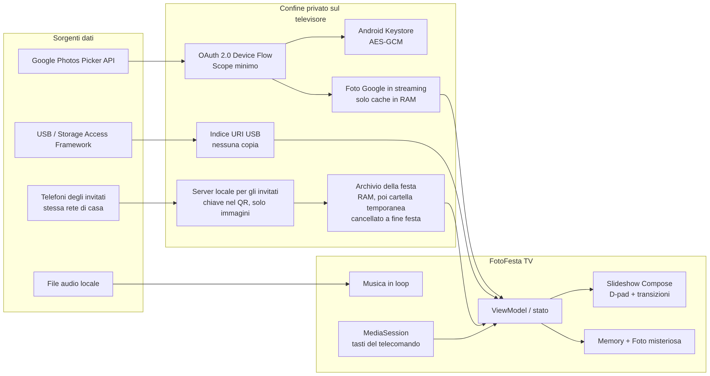

# FotoFesta TV

**FotoFesta TV** è un’app Android nativa per Android TV e Google TV che mostra fotografie in slideshow direttamente da una cartella USB oppure da una selezione sicura in Google Foto. Include durata regolabile, tre transizioni, adattamento immagine, ordine casuale, musica locale, controlli D-pad, Google Cast Connect e due minigiochi basati sulle fotografie attive.

Il repository contiene anche la versione per **Apple TV** (cartella [`apple/`](apple/README.md)), scritta in Swift e SwiftUI, con le stesse funzioni tranne USB, musica, salvaschermo e Cast, che tvOS non consente.

> **Stato del progetto:** versione 1.2.0 per Android TV e 1.0 per Apple TV, pronte per la prima pubblicazione dopo le verifiche indicate in [Verifica effettuata](#verifica-effettuata). L’app funziona subito con foto demo, USB, musica e giochi. Per Google Foto occorre inserire un proprio client OAuth; per ricevere sessioni Cast occorre registrare il ricevitore nella Google Cast SDK Developer Console. La procedura completa per Google Play e App Store è in [PUBLISHING.md](docs/PUBLISHING.md).



## Funzionalità implementate

| Area | Funzione | Stato |
| --- | --- | --- |
| Sorgenti | Foto demo incluse | Pronta |
| Sorgenti | Cartella su hard disk USB tramite Storage Access Framework | Pronta; nessuna copia delle foto |
| Sorgenti | Google Photos Picker API con autorizzazione TV e QR | Pronta nel codice; richiede credenziali OAuth del proprietario |
| Slideshow | Durata 3, 5, 8, 12 o 20 secondi | Pronta |
| Slideshow | Dissolvenza, scorrimento e zoom dolce | Pronta |
| Slideshow | Foto intera o riempimento schermo, shuffle, orologio | Pronta |
| Slideshow | Movimento lento (effetto Ken Burns) e pausa automatica dopo 30, 60 o 120 minuti | Pronta |
| Accessibilità | Focus visibile, D-pad, tasti media, riduzione movimento, contrasto elevato | Pronta |
| Audio | Brano locale selezionato dall’utente, loop e volume | Pronta |
| Chromecast | Ricevitore Cast Connect, `MediaSession` e protocollo JSON v1 | Pronta nel codice; registrazione Cast richiesta |
| Salvaschermo | Foto dell’ultima raccolta quando la TV è inattiva, con dissolvenza, movimento lento e orologio che cambia angolo | Pronta |
| Giochi | Memory dei ricordi | Pronta |
| Giochi | Foto misteriosa | Pronta |
| Privacy | Nessuna pubblicità né analisi proprie; token AES-GCM in Android Keystore. Il Cast SDK di Google invia a Google dati di utilizzo e diagnostica ([DATA_SAFETY.md](docs/DATA_SAFETY.md)) | Pronta |
| Lingue | Italiano e inglese (predefinito per le altre lingue del televisore) | Pronta |
| Google Play | Banner Leanback 320×180 nell’app; per la scheda icona 512×512, grafica 1024×500 e banner TV 1280×720; AAB firmato | Pronta |
| Apple TV | App tvOS 17+ con icona a livelli, Top Shelf, italiano e inglese | Da compilare e provare su un Mac ([apple/README.md](apple/README.md)) |

## Scelta dell’approccio

| Approach | Tradeoffs | Cost | Setup Complexity |
| --- | --- | --- | --- |
| **App Android TV nativa, questo progetto** | Copre USB, D-pad, musica, giochi, cache privata e Cast Connect. Richiede configurazione OAuth e registrazione Cast per le rispettive funzioni. | Nessun costo operativo dell’app. Possono applicarsi i costi degli account sviluppatore Google Play e Cast. | Media |
| **Usare solo la Modalità Ambient di Google Foto** | È l’alternativa più leggera e non richiede sviluppo, ma non offre USB, musica personalizzata, transizioni complete, giochi o protocollo Cast dell’app. | Nessun costo dell’app personalizzata. | Bassa |
| **Sender web/mobile con ricevitore Web Cast** | Funziona anche su Chromecast senza app Android TV installata, ma l’accesso USB locale e l’esperienza TV nativa sono più limitati. | Hosting HTTPS e registrazione Cast. | Medio-alta |

Il progetto implementa il primo approccio perché è l’unico che soddisfa contemporaneamente tutti i requisiti. Le altre due opzioni restano alternative valide se vengono eliminate funzioni essenziali.

## Installazione rapida dell’APK di prova

1. Attivare **Opzioni sviluppatore** e **Debug USB/rete** sulla Google TV.
2. Collegare `adb` alla TV.
3. Installare il file:

```bash
adb install -r dist/FotoFesta-TV-debug.apk
```

L’APK debug è firmato con certificato di sviluppo. Per una distribuzione reale usare l’Android App Bundle e una chiave di release, preferibilmente tramite Play App Signing.

## Compilazione

```bash
./scripts/setup_android_sdk.sh
./scripts/build.sh
```

La guida [CONFIGURATION.md](docs/CONFIGURATION.md) descrive Google Foto, Cast Connect e firma release. Il protocollo è specificato in [CAST_PROTOCOL.md](docs/CAST_PROTOCOL.md). Per pubblicare su Google Play e App Store segui [PUBLISHING.md](docs/PUBLISHING.md). L’app Apple TV si compila con Xcode come spiegato in [apple/README.md](apple/README.md).

## Architettura e flussi dati

La lettura USB usa `ACTION_OPEN_DOCUMENT_TREE`, che concede accesso solo alla cartella scelta e alle sue sottocartelle.[3] Google Foto usa il nuovo Picker, perché dal 31 marzo 2025 la Library API non consente più a un’app di elencare l’intera libreria dell’utente.[1] L’utente seleziona esplicitamente le foto dal telefono; l’app ne scarica una copia nel proprio archivio privato (escluso dal backup), necessaria perché le `baseUrl` della Picker API scadono dopo circa 60 minuti.[2]

Il flusso OAuth usa il meccanismo Google per TV e dispositivi a input limitato: la TV mostra URL e codice e l’utente autorizza da un telefono.[8] Il solo scope richiesto è `photospicker.mediaitems.readonly`; una pubblicazione pubblica richiede la verifica OAuth di Google.[9]

Cast Connect segue il modello Sender/Receiver di Google Cast. Il ricevitore Android TV accetta comandi nel namespace `urn:x-cast:it.fotofesta.tv` e aggiorna la `MediaSession` per play, pausa e skip.[4] La registrazione assegna l’Application ID che dovrà essere condiviso con gli eventuali sender Android, iOS o Web.[10]

## Privacy e sicurezza

L’app non integra pubblicità, analytics, crash reporting esterno o un backend proprietario. L’unico componente che invia dati è il Cast SDK di Google, che trasmette a Google dati di utilizzo e diagnostica, compresi identificatori del dispositivo: va dichiarato nella scheda Sicurezza dei dati come descritto in [DATA_SAFETY.md](docs/DATA_SAFETY.md). Gli URI USB e del brano musicale rimangono sul televisore e sono esclusi dal backup. I token Google sono cifrati con una chiave AES-GCM non esportabile conservata da Android Keystore. Le foto Google si trovano nell’area privata dell’app e si cancellano, insieme alla revoca dell’accesso, con “Disconnetti e cancella”. Il traffico HTTP in chiaro è disabilitato e il protocollo Cast accetta soltanto URL HTTPS. L’informativa privacy e la pagina di supporto da pubblicare sono in [`site/`](site/).

Queste scelte applicano minimizzazione e privacy by design. Prima di una pubblicazione pubblica devono comunque essere completate l’informativa definitiva, la scheda Data Safety e la verifica OAuth in base al titolare effettivo e ai paesi di distribuzione.[7] [9]

## Compatibilità e qualità

Il progetto usa `minSdk 26`, `targetSdk 35` e `compileSdk 35`. Il target supera il minimo richiesto per nuove app Android TV nel 2026.[6] Il manifest espone `LEANBACK_LAUNCHER`, dichiara il touchscreen non necessario e include un banner TV. I controlli principali sono utilizzabili con D-pad; nello slideshow i controlli si nascondono dopo 5 secondi, centro alterna play/pausa, sinistra/destra cambiano foto e su/giù mostrano la barra dei comandi, dove le frecce spostano il focus tra i pulsanti. La foto successiva viene precaricata per transizioni senza attese. Il pacchetto include ABI a 32 e 64 bit; la versione 1.0.0 ha superato il controllo `zipalign -P 16` per l’allineamento 16 KB, da ripetere sull’AAB di ogni release.[5] [11]

L’architettura separa modello, repository e protocollo dall’interfaccia. Questo permette di riutilizzare il protocollo Cast e la logica di dominio per un futuro sender iOS senza compromettere il client Android TV.

## Limiti intenzionali della prima versione

Google Foto non espone più l’intera libreria a un’app di terze parti: l’utente deve selezionare i contenuti per ogni nuova raccolta. La cache viene sostituita alla selezione successiva. Il progetto mostra immagini, non video. Il sottofondo musicale è un file locale scelto sulla TV e non viene inviato dal sender Cast. Il salvaschermo di sistema mostra l’ultima raccolta scelta nell’app (cache Google Foto, cartella USB o foto demo) usando durata, adattamento, movimento lento e orologio delle impostazioni. Alcuni produttori, tra cui le Google TV recenti, nascondono la scelta dei salvaschermi di terze parti; in quel caso si può attivare via `adb`:

```bash
adb shell settings put secure screensaver_components it.fotofesta.tv/.dream.PhotoDreamService
adb shell settings put secure screensaver_enabled 1
```

Per tornare al salvaschermo predefinito basta scegliere un altro salvaschermo dalle impostazioni oppure ripetere il primo comando con il componente originale, letto prima con `adb shell settings get secure screensaver_components`.

## Verifica effettuata

**Android TV.** I 54 test unitari (protocollo Cast e validazione URL, ordine di riproduzione, movimento lento, ordinamento dei file, coerenza delle traduzioni e flusso Google Foto completo contro un server finto) passano con Kotlin 2.0.21 su JVM 17. In GitHub Actions ogni push su `main` e ogni pull request eseguono test, Android Lint e build dell’APK debug (`.github/workflows/android.yml`). Gli audit e le correzioni sono descritti in [AUDIT.md](docs/AUDIT.md).

La versione 1.2.0 è stata sviluppata in un ambiente senza Android SDK, quindi la build Gradle completa e Android Lint vanno eseguiti con `./scripts/build.sh` o con la CI prima del primo caricamento. Serve poi la prova manuale su una TV reale descritta in [VALIDATION.md](docs/VALIDATION.md) e in [PUBLISHING.md](docs/PUBLISHING.md#3-verifiche-finali-prima-di-inviare).

Risultati della validazione della versione 1.0.0, l’ultima compilata con l’SDK:

| Controllo | Risultato 1.0.0 |
| --- | --- |
| Compilazione APK debug | Superata |
| Compilazione AAB release con shrinking R8 | Superata |
| Test unitari | 5/5 superati |
| Android Lint | 0 problemi |
| Firma APK debug | Verificata, schema v2 |
| ABI | `armeabi-v7a`, `arm64-v8a`, `x86`, `x86_64` |
| Allineamento 16 KB | Superato |

**Apple TV.** Il codice Swift non è ancora stato compilato, perché l’ambiente di sviluppo non aveva Xcode. Il workflow `.github/workflows/apple.yml` esegue i test del nucleo e compila l’app su un runner macOS. In alternativa si seguono i passi di [apple/README.md](apple/README.md) su un Mac.

## Riferimenti

[1]: https://developers.google.com/photos/support/updates "Updates to the Google Photos APIs"
[2]: https://developers.google.com/photos/picker/guides/media-items "List and retrieve media items"
[3]: https://developer.android.com/training/data-storage/shared/documents-files "Access documents and other files from shared storage"
[4]: https://developers.google.com/cast/docs/android_tv_receiver/core_features "Add Core Features to Your Android TV Receiver"
[5]: https://developer.android.com/docs/quality-guidelines/tv-app-quality "Android TV app quality"
[6]: https://support.google.com/googleplay/android-developer/answer/11926878 "Target API level requirements for Google Play apps"
[7]: https://commission.europa.eu/law/law-topic/data-protection/data-protection-eu_en "Legal framework of EU data protection"
[8]: https://developers.google.com/identity/protocols/oauth2/limited-input-device "OAuth 2.0 for TV and Limited-Input Device Applications"
[9]: https://developers.google.com/photos/overview/authorization "Google Photos API authorization scopes"
[10]: https://developers.google.com/cast/docs/registration "Google Cast application registration"
[11]: https://developer.android.com/guide/practices/page-sizes "Support 16 KB page sizes"
